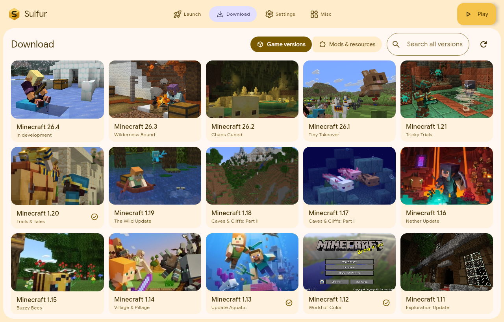
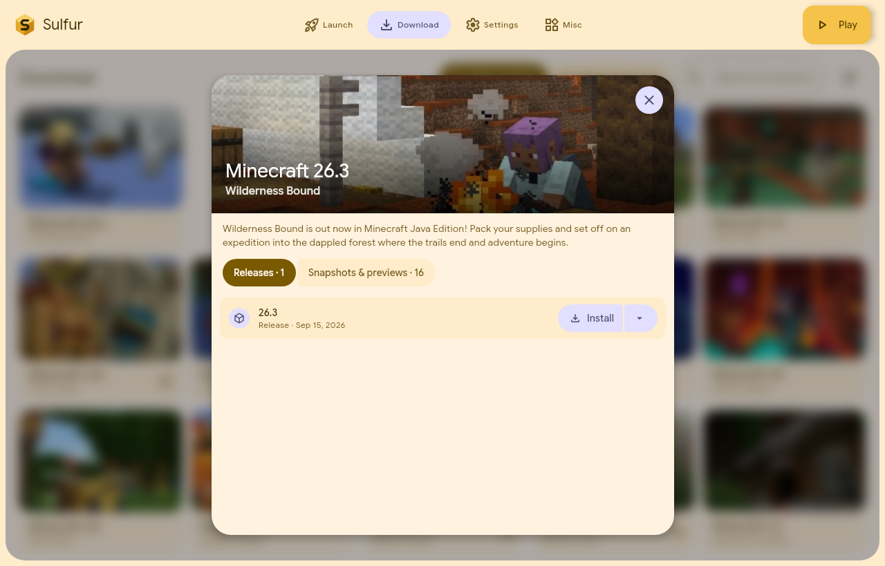

<p align="center"></p>

# Sulfur

A Minecraft launcher for everyone. A Rust core does the heavy lifting
(downloads, installs, launching); the interface is native Compose Multiplatform
with Google's **Material 3 Expressive** components.





## Highlights

- **Fast, resilient downloads.** Thousands of small files in parallel over
  256 HTTP/1.1 connections, large files split into ranges with work stealing,
  stalled ranges taken over, checksums verified, mirror fallback (BMCLAPI for
  the game and loaders, MCIM for Modrinth and CurseForge).
  See [docs/DOWNLOAD_ENGINE.md](docs/DOWNLOAD_ENGINE.md).
- **Nothing downloaded twice.** Existing files are hash-checked and skipped;
  files from other game folders (e.g. the official `.minecraft`) are
  hard-linked or copied instead of downloaded.
- **Version isolation by default.** Each version keeps its own saves, mods and
  options in `versions/<id>/`; switch to a shared folder globally or per version.
- **Mod loaders and mods.** Install Fabric (with Fabric API), Quilt, Forge,
  NeoForge, OptiFine, Legacy Fabric, Ornithe, Cleanroom (1.12.2) or Rift
  (1.13.2); Forge-style installers run locally like the official ones.
  Opening a version shows every loader with its logo, and loaders that do
  not support that version as unavailable. The
  Mods & resources tab of the Download page searches Modrinth, CurseForge or
  both at once (the same project on both sites shows as one result) for mods,
  resource packs, data packs and shaders, and installs mods with their
  required dependencies into a version's own folders. Each version's
  settings page lists its mods, resource packs and shaders to turn on or
  off or remove.
- **Modpacks.** The Modpacks tab searches Modrinth and installs a pack (or a
  `.mrpack` file from disk) as a version of its own: the game, its mod loader,
  the pack's files and its overrides, in an isolated folder.
- **Java taken care of.** Sulfur picks the right installed Java per version
  and downloads the right one (Eclipse Temurin) when none fits.
- **Settings per version.** A page of its own, opened beside Play: any version can have its own Java, memory, window,
  JVM and game arguments, garbage collector, wrapper command (e.g.
  `gamemoderun`), pre-launch command, environment variables and a server to
  join on start; anything left empty follows the global settings.
- **Garbage collector presets.** G1 tuned as the official launcher does,
  generational ZGC, Shenandoah or Parallel, with flags the chosen Java lacks
  left out.
- **Log4Shell patched** for Minecraft 1.7–1.18.0 with Mojang's fixed logging
  configuration and JVM arguments (can be turned off).
- **Every update at a glance.** The Download page shows each major update as a
  card with its official key art (from the
  [Minecraft Update Artwork](https://github.com/TQNL/minecraft-update-artwork)
  archive, the launcher and the Minecraft Wiki); open one to see its releases
  and snapshots.
  Betas, alphas and Mojang's April Fools versions have cards of their own.
  Search finds versions by id or by update name, in English or the UI language
  (`caves`, `洞穴`).
- **Lost versions.** The Archive tab lists client jars preserved by
  [Omniarchive](https://omniarchive.net) that Mojang no longer offers (indev,
  lost alphas, pre-releases, 2.0) by file name, and starts them like the
  nearest official version of their era.
- **Comes with you from HMCL and PCL.** Settings → Game imports game folders,
  memory, window, Java, download and isolation settings from HMCL (3.16+ and
  older `hmcl.json`), PCL Community Edition and PCL2.
- **English, 简体中文 and 繁體中文**, following the system or picked in
  Settings → Appearance.
- **Material 3 Expressive UI.** Page entries in a top bar or a wide
  navigation rail, split and connected button groups, wavy progress, morphing
  loading indicators, expressive shapes and motion, dynamic color from a seed
  color, the desktop wallpaper or the background picture, Google Sans Flex,
  and an optional background picture with opacity and blur.
- **A Launch page of your own.** Put the Play column on the left or right
  and add cards beside it: Minecraft news, the latest versions, notes, links
  or a Markdown page from a file or the web.
- **Targets Windows 10+, macOS and Linux (x64 and arm64).** Tested so far on
  Linux arm64, where the installer swaps in LWJGL's official arm64 natives so
  current Minecraft runs natively.

## Layout

```
core/                 Rust workspace members
  sulfur-core/        paths and persisted settings
  sulfur-download/    download engine
  sulfur-minecraft/   metadata, install, loaders, Java discovery, launch
  sulfur-mods/        Modrinth and CurseForge clients, .mrpack modpacks
  sulfur-ffi/         UniFFI facade consumed by Kotlin (the only FFI surface)
  uniffi-bindgen/     generates the Kotlin bindings
  sulfur-bundle/      the single-executable stub and its packer
app/                  Kotlin + Compose Multiplatform desktop app
docs/                 architecture, engine and platform notes
```

More in [docs/ARCHITECTURE.md](docs/ARCHITECTURE.md).

## Building

Requirements: Rust (stable, 1.85+), JDK 21+ (17+ for packaging), and the usual
native toolchain for your OS. Gradle builds the Rust core and the bindings for you.

The first build also downloads the MiSans font (about 20 MB, from Xiaomi) for
Chinese and Japanese. Its license lets apps embed it but not redistribute the
font files, so it is not in the repository. Offline, pass
`-Psulfur.cjkFont=/path/to/MiSansVF.ttf`, or `-Psulfur.cjkFont=none` to build
without it (the system's CJK font is used instead).

The default build makes the whole app one executable for this OS
(`app/build/compose/binaries/main-release/single/Sulfur-<version>-<os>-<arch>`);
`./gradlew build` and `./gradlew :app:packageSingleExecutable` make it too:

```bash
./gradlew
```

To run from the sources instead, or to make the usual installers
(DMG, MSI, DEB, RPM, AppImage):

```bash
./gradlew :app:run
```

```bash
./gradlew :app:packageDistributionForCurrentOS
```

The executable carries the app folder compressed inside it, unpacks it once into the
user's cache (about a second) and starts it from there; later starts reuse
it. On macOS a DMG is still the better download, since Finder opens a bare
executable in Terminal.

Useful extras:

```bash
cargo test --workspace
```

```bash
./gradlew :app:screenshots -Pout=$PWD/docs/screenshots
```

```bash
./gradlew :app:screenshots -Pshots=launch-light,settings-light
```

```bash
cargo run --release -p sulfur-minecraft --example install -- 1.21.11 ./mc --launch Steve
```

```bash
cargo run --release -p sulfur-minecraft --example install -- 1.21.1 ./mc --loader fabric
```

Set `SULFUR_PORTABLE=<dir>` (or `-Dsulfur.portable=<dir>`) to keep all data in
one folder, and `SULFUR_LOG=debug` for verbose logs in `<data>/logs/sulfur.log`.


## Status

Early framework. Working today: version list grouped by update, installing any
vanilla version, nine mod loaders, Modrinth and CurseForge projects, Java
discovery and downloads, launching with isolation, settings, background
pictures, settings import from HMCL and PCL, and three UI languages.

Microsoft accounts sign in with a device code (the build needs an
application ID, see [docs/MICROSOFT_SIGN_IN.md](docs/MICROSOFT_SIGN_IN.md)).
Offline accounts are available in mainland China, where Minecraft: Java
Edition is not sold (the region comes from the system time zone, as in HMCL),
and elsewhere next to a signed-in Microsoft account that owns the game;
add as many offline names as you like from the account menu.

Planned: CurseForge modpacks and Alkaline Client.
See [docs/PLATFORMS.md](docs/PLATFORMS.md) for platform support details.
